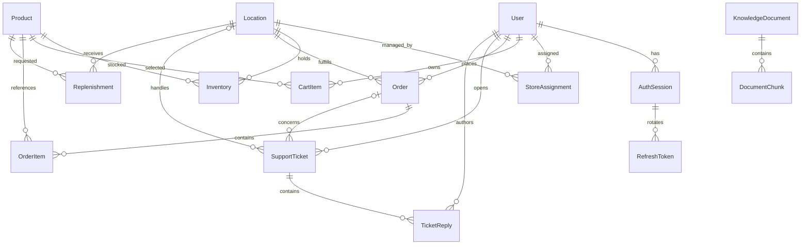

# RetailPulse AI MVP

React + Vite frontend, Node.js + Express API, Prisma and Neon PostgreSQL with pgvector. There is no payment gateway interface. Checkout records a simulated payment and creates an order after checking stock.

## Run locally

Requires Node.js 22.12 or newer and a PostgreSQL database supporting the vector extension.

```powershell
npm install
npm run db:generate
npm run db:deploy
npm run db:seed
npm run dev
```

Configure `backend/.env` from `backend/.env.example` before database commands. Use the pooled Neon URL for `DATABASE_URL`, a direct URL for `DIRECT_URL`, a random signing secret of at least 48 characters for `JWT_SECRET`, and a demo password of at least 12 characters for `DEMO_PASSWORD`. Actual credentials stay in the ignored environment file.

Open http://127.0.0.1:5173. The API runs on port 4000. The frontend proxies `/api` to the API. Keep `APP_ORIGIN` aligned with the frontend origin for refresh/logout cookie protection. The development command runs the web app, API and knowledge ingestion worker together.

## Demo accounts

All seeded accounts use the password configured as `DEMO_PASSWORD` in `backend/.env`. The seed preserves existing accounts and stock on repeat runs, so changing this variable does not reset an existing account's password.

| Email | Access |
| --- | --- |
| customer@retailpulse.demo | Standard customer |
| silver@retailpulse.demo | Silver customer |
| gold@retailpulse.demo | Gold customer |
| platinum@retailpulse.demo | Platinum customer |
| manager@retailpulse.demo | Store manager assigned to Indiranagar |
| manager.bengaluru@retailpulse.demo | Bengaluru store manager |
| manager.mumbai@retailpulse.demo | Mumbai store manager |
| manager.warehouse@retailpulse.demo | Central fulfillment manager for delivery orders |
| admin@retailpulse.demo | All-location operations and document administration |

Customers can also register through the sign-in dialog. Roles control access; membership tiers control demo benefits and applicable policies.

The demo catalogue contains 24 products: 16 shared products and four exclusive additions at each physical store. The warehouse carries delivery stock. Selecting a store limits the catalogue to its assortment. Category-specific filters use stored product attributes such as RAM, storage, battery life, connectivity and capacity; rating, price and brand controls also apply.

Order-related support tickets use the order's actual fulfillment location and require ownership of that order. Assigned managers can answer, escalate or resolve; admins can answer and resolve across locations. Staff must send an answer before resolving. Customers see answers with author names, role labels and timestamps, including on resolved tickets. General questions use the selected physical store. Delivery-order tickets route to the warehouse manager because that location fulfills delivery orders.

## Code structure

```text
frontend/src/
  components/        Feature forms, dialogs and shopping flows
  App.tsx            Catalogue, navigation and shared UI state
  api.ts             Typed API calls and in-memory JWT handling
  ProductArt.tsx     Local vector product imagery
  styles.css         Responsive interface
backend/
  prisma/            Schema, versioned SQL migration and sample data
  src/
    routes/          Endpoints and permission middleware
    controllers/     Request/response handling
    services/        Business rules and database transactions
    middleware/      Authentication, authorization and error responses
    errors/          Application error type and assertion helper
    config/          Environment validation and Prisma connection pool
    validators/      Authentication/profile input schemas
    lib/             Pricing and status-transition rules
    app.ts           Express configuration
    server.ts        HTTP process
    worker.ts        Asynchronous document ingestion
  tests/             Pricing and opt-in Neon integration checks
deliverables/        MVP panel design
```

Routes enforce role permissions. Controllers translate HTTP inputs and outputs. Services validate domain inputs, enforce ownership/location access and run transactions. Prisma owns relational persistence. Comments explain decisions around checkout locks, retry handling, refresh rotation, policy applicability and native vector SQL.

## Database schema

The application uses **Neon PostgreSQL**, with **Prisma** for relational data and **pgvector** for policy embeddings. The source of truth is [backend/prisma/schema.prisma](backend/prisma/schema.prisma); [SQL migrations](backend/prisma/migrations) also define database constraints and enable the vector extension.

### Entity relationships



`AuditLog` is independent of foreign-key relationships so its actor and resource identifiers remain available when related business records are removed. `Replenishment.requestedBy` and `approvedBy` are also stored identifiers, not Prisma foreign-key relations.

### Tables and fields

All tables have a string `id` primary key with a UUID default, except `StoreAssignment`, which uses a composite primary key. Seed data can supply readable string IDs. `?` below means nullable; timestamps use Prisma `DateTime`. Relation fields are represented by their foreign-key columns.

| Table | Fields besides the primary key | Purpose / constraints |
| --- | --- | --- |
| `User` | `email`, `name`, `passwordHash`, `role`, `tier`, `active`, `preferences` (JSON), `createdAt` | Accounts, permissions and membership benefits. Email is unique; passwords are hashed. Defaults: customer, standard tier, active. |
| `AuthSession` | `userId`, `expiresAt`, `revokedAt?`, `createdAt` | Revocable authenticated sessions belonging to a user. Indexed by user. |
| `RefreshToken` | `hash`, `sessionId`, `consumed`, `expiresAt` | Rotating refresh tokens; only unique hashes are stored. Session deletion cascades to tokens. |
| `Location` | `name`, `city`, `address`, `warehouse`, `expressAvailable` | Physical stores and warehouses share the same model. |
| `StoreAssignment` | `userId`, `locationId` | Manager-to-location mapping. Composite primary key `(userId, locationId)` prevents duplicate assignments. |
| `Product` | `sku`, `name`, `category`, `brand`, `description`, `price`, `originalPrice?`, `rating`, `color`, `specifications` (JSON), `active`, `featured` | Shared catalogue. SKU is unique. Prices are `Decimal(12,2)`; rating is `Decimal(2,1)`. Category/active and brand are indexed. |
| `Inventory` | `productId`, `locationId`, `quantity`, `reorderPoint`, `targetStock`, `updatedAt` | Available stock per location. Unique `(productId, locationId)`; quantity cannot be negative. `updatedAt` guards reviewed stock adjustments against concurrent changes. |
| `CartItem` | `userId`, `productId`, `quantity` | Unique `(userId, productId)`; quantity must be positive. A cart does not reserve stock. |
| `Order` | `number`, `userId`, `locationId`, `fulfillment`, `status`, `subtotal`, `deliveryCharge`, `total`, `address?`, `simulatedPayment`, `idempotencyKey`, `requestHash`, `createdAt` | Number is unique. Unique `(userId, idempotencyKey)` prevents duplicate checkout orders. Monetary values use `Decimal(12,2)`. Indexed by user/date and location/status. |
| `OrderItem` | `orderId`, `productId`, `name`, `quantity`, `unitPrice` | Historical product-name and price snapshots. Quantity must be positive; unit price uses `Decimal(12,2)`. |
| `SupportTicket` | `userId`, `locationId?`, `orderId?`, `subject`, `description`, `priority`, `status`, `createdAt` | Customer support, optionally linked to an order and handling location. Indexed by location/status, user/date and order. Priority and status are strings. |
| `TicketReply` | `ticketId`, `authorId`, `authorRole`, `body`, `createdAt` | Customer-visible staff replies; author role is captured when sent. Indexed by ticket/date. |
| `Replenishment` | `productId`, `locationId`, `quantity`, `reason`, `status`, `requestedBy`, `approvedBy?`, `createdAt` | Requests to add stock. Quantity must be positive. Indexed by location/status; stock increases on receipt. |
| `KnowledgeDocument` | `title`, `version`, `country`, `category`, `documentType`, `tiers` (Tier array), `audience` (Role array), `effectiveFrom`, `effectiveTo?`, `active`, `status`, `filePath?`, `originalFile?` (Bytes), `fileName?`, `error?`, `leaseUntil?`, `attempts`, `embeddingModel?`, `retrievalMode`, `createdAt` | Policy scope, publication and ingestion metadata. Unique `(title, version, country, category)`. Private original file bytes persist in PostgreSQL. |
| `DocumentChunk` | `documentId`, `section`, `content`, `embedding?` (`vector(1536)`) | Policy passages and embeddings for RAG. Document deletion cascades to chunks. Prisma declares the native vector column as `Unsupported`; retrieval uses parameterized SQL. |
| `AuditLog` | `actorId`, `action`, `resourceId`, `details` (JSON), `createdAt` | Operational history. Exact stock adjustments record product/location, previous count, new count, difference and reason. Indexed by actor/date. |

### Enum values

| Enum | Values |
| --- | --- |
| `Role` | `CUSTOMER`, `STORE_MANAGER`, `ADMIN` |
| `Tier` | `STANDARD`, `SILVER`, `GOLD`, `PLATINUM` |
| `Fulfillment` | `PICKUP`, `DELIVERY` |
| `OrderStatus` | `PLACED`, `READY_FOR_PICKUP`, `COLLECTED`, `PROCESSING`, `SHIPPED`, `DELIVERED`, `CANCELLED` |
| `DocumentStatus` | `QUEUED`, `PROCESSING`, `READY`, `FAILED` |
| `ActionStatus` | `PROPOSED`, `APPROVED`, `REJECTED`, `RECEIVED` |

### Business rules enforced by services

- Role, customer ownership and manager location access are checked by the backend; foreign keys alone do not enforce these permissions.
- Checkout validates stock and updates it transactionally. Eligible cancellations restore stock once; checkout retries return the existing order.
- One pending replenishment (`PROPOSED` or `APPROVED`) per product/location is enforced with a transaction lock. Approval leaves quantity unchanged; receipt adds the requested units once.
- Admins and assigned managers can set an exact available count after reviewing a signed action. Confirmation checks the inventory version and saves an audit entry in the same transaction; repeated confirmations do not overwrite later stock changes.
- RAG filters active, ready documents by audience, tier, category, country and effective dates before retrieving chunks.

## AI configuration

For OpenAI, set `OPENAI_API_KEY` in `backend/.env`. The default chat model is `gpt-4.1-mini` (override with `OPENAI_CHAT_MODEL`); embeddings use `text-embedding-3-small` with 1536 dimensions. The same key is used for both. Existing `AI_BASE_URL` / `AI_API_KEY` / `AI_MODEL` and separate `EMBEDDING_*` settings remain supported and override the defaults. Credentials are used only by the backend.

Policy RAG follows upload → paragraph extraction/chunking → batched OpenAI embeddings → PostgreSQL `vector(1536)` storage → cosine retrieval → grounded answer with source links. The initial Prisma migration enables the `vector` extension. Exact nearest-neighbor search is appropriate for this small MVP corpus; no separate vector database is required. Documents are filtered by role, tier, category, country, status, activation and effective dates before retrieval. Answers without supporting evidence direct the user to support; generated citation IDs are checked against retrieved passages.

The chatbot keeps conversation in memory for the current signed-in page, preserves it when closed/reopened, and clears it on account changes or New chat. The backend accepts at most eight prior messages and rewrites follow-up questions for retrieval. History provides context, not policy evidence. Approved-action buttons come from a backend role allowlist and open existing review forms; mutation endpoints independently enforce role, order ownership, assigned locations and status transitions. Product recommendations remain available under Find products.

Upload documents in the admin Knowledge panel, wait for READY, then activate the version. Rebuild embeddings reprocesses older lexical documents or failed uploads. Restart the API and worker after changing environment variables. Without provider keys, approved policy excerpts remain available through lexical retrieval. Activation prevents overlapping versions with the same policy scope.

To load the three supplied demo policies while the app and worker are running:

```powershell
npm run rag:setup -w backend
```

This development-only command signs in through the admin API, uploads the files in `policies/`, waits for vector ingestion, retires only their known seeded demo-1 predecessors, and activates the new versions. It requires the seeded administrator's current password to match `DEMO_PASSWORD`. Do not use it for real business policies.

Uploads support PDF, Markdown, text, CSV and JSON up to 4 MB. Private original files are stored in PostgreSQL and omitted from API responses. On Vercel, ingestion runs within the upload/reindex request; locally, the worker processes queued documents. Scanned PDFs need OCR and are outside this MVP.

## Vercel hosting

The root `vercel.json` deploys the Vite frontend and Express API together using Vercel Services (beta). `/api/*` reaches Express and the remaining routes reach the frontend, keeping authentication on the same origin. The backend generates its Prisma client during the build. Apply migrations with `npm run db:deploy` before deploying.

Configure `DATABASE_URL`, `JWT_SECRET`, `OPENAI_API_KEY`, `NODE_ENV=production`, and `APP_ORIGIN` (the exact production HTTPS origin) in Vercel. Provider/model overrides are optional. Never prefix backend secrets with `VITE_`. Local `.env`, uploads, tests, and deliverables are excluded by `.vercelignore`. Policy ingestion has a 300-second function limit; failed or interrupted ingestion can be rebuilt from the admin Knowledge panel.

Only admins can upload, activate or retire policies; the API checks this permission before accepting files. Upload-ready fictional policies and their titles/versions are in `policies/README.md`. Uploading and activation are separate steps. Customer policy answers use applicable active documents; staff ticket replies remain human-authored.

## Verification

```powershell
npm run check
npm run build
npm test
$env:RUN_DB_TESTS='true'
npm run test:integration -w backend
```

The database tests require seeded demo products and remove their temporary records after checking catalogue controls, JWT permissions, checkout retries, stock restoration, document ingestion/publication, tier-restricted citations, saved preferences, support escalation and store assignments. The test bootstrap clears provider keys in test processes; model responses are mocked where needed. RAG checks exercise real pgvector ranking, role/tier/date/category filtering, retired documents, citation validation and chat limits. Recommendation checks verify budget/specification enforcement and reject invented product IDs. Pricing tests cover tier thresholds and fulfillment status rules. Integration tests are skipped by the default test command unless `RUN_DB_TESTS=true`. Stop the separate ingestion worker during automated tests if you also want to prevent it from embedding temporary test uploads with its own environment.

## Scope and references

Implementation follows `RetailPluseAI_Hackathon_Usecase.docx` and `deliverables/RetailPulse_AI_MVP_Panel_Design.docx`. The executable schema is `backend/prisma/schema.prisma`.

The MVP uses deterministic business services and explicitly approved operational actions. Account controls support roles, membership, active status and assigned staff locations. Customers can save their preferred store; staff can escalate and resolve support tickets. Full autonomous agents, demand forecasting, promotion management, external stock synchronization, OCR and real payments are later work.

Dependency review: the CSV parser was updated to a patched release. npm audit currently reports four high-severity findings through Prisma CLI dependencies (`deepmerge-ts` and `mysql2`, plus parent packages). The app uses PostgreSQL; no MySQL integration is implemented. A Prisma major-version downgrade was not applied automatically. Recheck the dependency audit before deployment.
